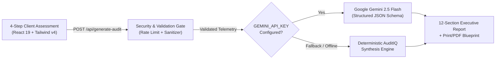

# AuditIQ — AI Business Intelligence & Readiness Platform

<div align="center">


**Evaluate operational workflows, uncover hidden bottlenecks, and generate a tailored AI & automation implementation blueprint in under 3 minutes.**

Built by **[MSL AI Systems](https://msl-portfolio.vercel.app)** • Engineered by **Muhsin Alonigbeja**

</div>

---

## Overview

**AuditIQ** is an AI-powered Business Intelligence and Operational Readiness platform built for growing businesses, agencies, and enterprise teams. Through a structured 4-step diagnostic intake, AuditIQ evaluates a company's daily workflows, software stack, and customer hand-off friction to produce an executive-grade **Business Intelligence Diagnostic Report** (complete with print/PDF export and a 3-phase implementation roadmap).

### Core Diagnostic Indexes

| Index | What It Measures | Output |
| :--- | :--- | :--- |
| **1. Business Health Score** (`0–100`) | Workflow digitization, clerical integrity, and cross-app data hygiene. | Identifies manual copy-pasting and revenue leakage. |
| **2. AI Adoption Readiness** (`0–100`) | Cloud tool maturity, structured data availability, and API readiness. | Maps feasibility for custom virtual AI agents. |
| **3. Workflow Automation Index** (`0–100`) | Repeatability of rules-based operations (intake, scheduling, reporting, invoicing). | Prioritizes immediate n8n / webhook automation triggers. |

---

## System Architecture



### Repository Structure

```text
auditiq/
├── api/
│   └── generate-audit.mjs        # Vercel Serverless Function endpoint (POST /api/generate-audit)
├── public/
│   ├── index.html                # Application entry point
│   └── assets/
│       ├── app.js                # AuditIQ SPA bundle (4-step wizard + 12-section report + print cover)
│       ├── styles.css            # Base Tailwind CSS v4 design tokens
│       └── ui-enhancements.css   # UI/UX Pro Max & accessibility refinement layer
├── src/
│   ├── engine.mjs                # Dual-mode Gemini 2.5 Flash + deterministic diagnostic synthesis engine
│   └── validation.mjs            # Strict schema validation, length caps, XSS & prompt-injection stripping
├── scripts/
│   ├── build-public.mjs          # Deterministic frontend asset builder & patch verifier
│   └── verify-ui.mjs             # Headless Playwright end-to-end visual & functional verification
├── tests/
│   └── auditiq.test.mjs          # Node.js automated TDD & security verification test suite
├── server.mjs                    # Standalone Node.js HTTP server for local/container deployments
├── vercel.json                   # Vercel routing, security headers, and serverless configuration
├── SECURITY.md                   # Security controls & vulnerability remediation audit log
└── package.json                  # Project manifest and scripts
```

---

## Security & Reliability Engineering

AuditIQ v2.0.0 is hardened for public production deployment:

- **Strict HTTP Security Headers (`SEC-01`):** Enforces `Content-Security-Policy`, `X-Content-Type-Options: nosniff`, `X-Frame-Options: DENY`, `Referrer-Policy: strict-origin-when-cross-origin`, `Permissions-Policy`, and `Strict-Transport-Security` while suppressing server fingerprinting (`X-Powered-By`).
- **Prompt-Injection & XSS Sanitization (`SEC-02`):** [`src/validation.mjs`](./src/validation.mjs) enforces strict enum allowlists, character caps (`120–600` chars), ASCII control-character removal, HTML/script tag stripping, and LLM role/delimiter filtering (`<|...|>` / ```` ```system ````).
- **Sliding-Window Rate Limiting & Payload Caps (`SEC-03`):** Protects LLM quota per IP (`HTTP 429 Too Many Requests` with `Retry-After`) and enforces a strict `32KB` JSON request body limit.
- **Zero-Downtime Dual Engine:** Calls Google's `gemini-2.5-flash` model when `GEMINI_API_KEY` is provided and automatically falls back to a deterministic, industry-calibrated diagnostic engine if external API connectivity is interrupted.

See [`SECURITY.md`](./SECURITY.md) for the complete security audit and remediation matrix.

---

## Quick Start (Local Development)

### 1. Clone & Configure Environment

```bash
git clone https://github.com/Ibnalkabeer/AuditIQ.git
cd AuditIQ
cp .env.example .env
```

Open `.env` and add your Google AI Studio Gemini API key:

```env
GEMINI_API_KEY=your_gemini_api_key_here
PORT=4650
```

### 2. Run the Automated Test Suite

AuditIQ uses Node's native test runner (`node:test`) with zero external dependencies required:

```bash
npm test
```

### 3. Start the Local Server

```bash
npm start
```

Open **http://localhost:4650** in your browser.

---

## Deploying to Vercel

AuditIQ is pre-configured for zero-config deployment on **Vercel** via [`vercel.json`](./vercel.json) and [`api/generate-audit.mjs`](./api/generate-audit.mjs):

1. Push this repository to GitHub (`https://github.com/Ibnalkabeer/AuditIQ`).
2. In your [Vercel Dashboard](https://vercel.com/new), click **Add New Project** and import the `AuditIQ` repository.
3. Under **Environment Variables**, add:
   - `GEMINI_API_KEY` = *(Your Google AI Studio API Key)*
4. Click **Deploy**. Vercel will serve the static frontend from `public/` and route `POST /api/generate-audit` to the serverless function in `api/generate-audit.mjs`.

---

## License & Attribution

© 2026 **MSL AI Systems**. Engineered by **Muhsin Alonigbeja**. All rights reserved.
- **Portfolio:** [msl-portfolio.vercel.app](https://msl-portfolio.vercel.app)
- **Direct Advisory (WhatsApp):** [+234 707 973 1073](https://wa.me/2347079731073)
- **Email:** [muhsinalonigbeja@gmail.com](mailto:muhsinalonigbeja@gmail.com)
